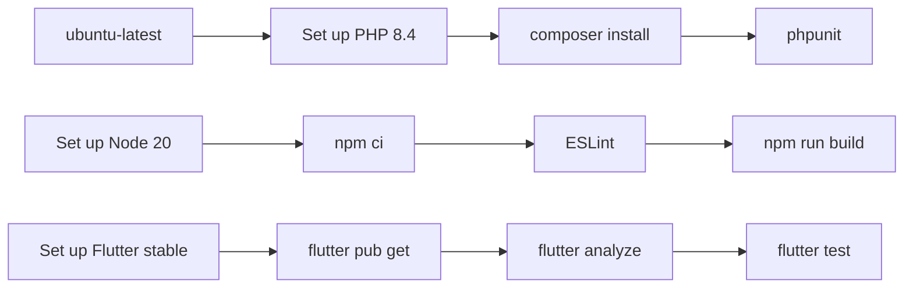
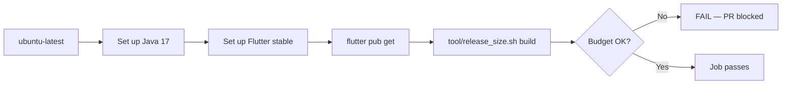

# 11 — Deployment Flow (Push → CI → CD → Deploy → Verify)

This document is the single source of truth for the **end-to-end deployment sequence** of OmniVote: from a developer pushing code, through GitHub Actions CI checks, to the production server deployment.

---

## 1. High-Level Flow

```mermaid
graph TD
    A[Developer pushes to main] --> B{GitHub Actions: deploy.yml}
    B --> C[Job: test]
    B --> D[Job: size]
    C --> E[All green?]
    D --> E
    E -->|No| F[Deploy NOT triggered]
    E -->|Yes| G[Job: deploy]
    G --> H[Connect to production tailnet]
    H --> I[SSH to omnivote-deploy@host]
    I --> J[deploy/deploy.sh]
    J --> K[1. Preflight safety checks]
    J --> L[2. Security config assertions]
    J --> M[3. Sync checkout + git reset --hard]
    J --> N[4. Build React admin console]
    J --> O[5. composer install (backend deps)]
    J --> P[6. Assert production config]
    J --> Q[7. Run migrations]
    J --> R[8. Rebuild caches]
    J --> S[9. Fix storage permissions]
    J --> T[10. public/storage symlink]
    J --> U[11. Restart queue worker + php-fpm]
    J --> V[12. Ensure backup timer enabled]
    V --> W[Deploy complete]
    W --> X[Verify: curl /up, /api/election/status]
```

---

## 2. Trigger Points

The `deploy.yml` workflow (`.github/workflows/deploy.yml`) has three trigger conditions:

| Trigger | Branches | Effect |
|---|---|---|
| `push` | `main` | Runs CI; deploy job runs if `test` + `size` pass |
| `pull_request` | `main` | Runs CI only; **deploy job is skipped** (CI checks, but no deploy) |
| `workflow_dispatch` | any | Manual trigger (useful for re-running failed deploys) |

### Deploy job gating conditions

The `deploy` job only runs when **all** of these are true:

```yaml
github.event_name != 'pull_request'
github.ref == 'refs/heads/main'
vars.PRODUCTION_DEPLOY_ENABLED == 'true'
```

> **Note:** Even when everything passes, the deploy is not automatic on every push — `PRODUCTION_DEPLOY_ENABLED` must be set to `true` in the GitHub repository's `production` environment variables.

---

## 3. CI Job 1 — `test` (GitHub-hosted runner)

Runs on `ubuntu-latest`. Checks three layers of the stack:



| Step | Command | What it validates |
|---|---|---|
| Backend dependencies | `composer install --prefer-dist --no-progress --no-interaction` | PHP packages install without errors |
| Backend tests | `vendor/bin/phpunit` | Unit/integration tests pass |
| Admin lint + build | `npm ci && npm run lint && npm run build` | React admin build succeeds, no lint errors |
| Flutter analyze + test | `flutter analyze && flutter test` | Dart code is clean, tests pass |

---

## 4. CI Job 2 — `size` (Release size budget)

Runs on `ubuntu-latest`. Builds the obfuscated release APK and enforces a size budget:



This prevents the APK from accidentally growing past the budget defined in `user-flutter/tool/release_size.sh`.

---

## 5. CD Job 3 — `deploy` (Production deployment)

Runs on `ubuntu-latest` with the `production` environment. Uses **ephemeral GitHub-hosted runner + Tailscale OIDC + SSH** — no persistent GitHub runner is installed on the production server.

### 5a. Connect to the production tailnet

```yaml
uses: tailscale/github-action@v4
with:
  oauth-client-id: ${{ vars.TS_OAUTH_CLIENT_ID }}
  audience:      ${{ vars.TS_AUDIENCE }}
  tags:          tag:omnivote-ci
  ping:          ${{ vars.DEPLOY_HOST }}
```

This creates a temporary Tailscale connection to the production server.

### 5b. SSH to the production server

The workflow sets up SSH credentials from GitHub secrets:

| Secret | Purpose |
|---|---|
| `DEPLOY_SSH_PRIVATE_KEY` | Deploy key for `omnivote-deploy` user |
| `DEPLOY_KNOWN_HOSTS` | Verified SSH host key (prevents MITM) |

Then it runs a restricted SSH command on the server:

```bash
ssh -i "$HOME/.ssh/omnivote_deploy" \
    -o IdentitiesOnly=yes \
    -o BatchMode=yes \
    -o StrictHostKeyChecking=yes \
    -o UserKnownHostsFile="$HOME/.ssh/known_hosts" \
    -o ConnectTimeout=15 \
    "omnivote-deploy@${DEPLOY_HOST}"
```

The SSH session executes `deploy/deploy.sh` on the server.

---

## 6. Server-Side Deploy Sequence (`deploy/deploy.sh`)

The deploy script runs with `set -euo pipefail` — it is **strict**: any failure aborts the deploy immediately, leaving the previous release intact.

### Step 1 — Preflight safety checks (read-only, before any change)

| Check | What it verifies |
|---|---|
| `$APP_DIR/.git` exists | Server is a valid git checkout |
| `git`, `php8.4`, `composer`, `npm` on PATH | Required tools installed |
| systemd units exist | `omnivote-worker.service`, `omnivote-backup.timer`, `php8.4-fpm.service` |
| Passwordless sudo for required commands | `omnivote-deploy-permissions`, `systemctl restart omnivote-worker.service`, `systemctl restart php8.4-fpm`, `systemctl enable --now omnivote-backup.timer` |
| `backend-laravel/.env` exists | Production environment config is present |

### Step 2 — Security config assertions (before anything goes live)

```bash
php artisan security:assert-production-config
```

This **fails the deploy** if the production `.env` is unsafe:

- `APP_DEBUG=true` ❌
- `SESSION_SECURE_COOKIE=false` ❌
- `APP_URL` not HTTPS ❌
- `APP_KEY` missing ❌
- `APP_ENV` not `production` ❌

> **Critical ordering:** The config gate runs **before** the `git reset --hard`, so a bad `.env` is caught before the server's code is touched. The previous release keeps serving traffic.

### Step 3 — Sync the checkout

```bash
git fetch --prune origin
git checkout "$BRANCH"        # default: main
git reset --hard "origin/$BRANCH"
```

The server becomes an exact mirror of the branch. **`.env` is untracked**, so it survives the reset and is never overwritten by git.

### Step 4 — Build the React admin console

```bash
cd admin-react
npm ci --no-audit --no-fund
npm run build
```

Vite writes the compiled admin SPA into `backend-laravel/public/admin/`. This runs on the same origin as `/api/`, so Sanctum cookie auth stays same-origin.

### Step 5 — Install backend dependencies

```bash
cd backend-laravel
COMPOSER_ALLOW_SUPERUSER=1 composer install --no-dev --optimize-autoloader --no-interaction
```

Production-only dependencies (no dev packages, optimized autoloader).

### Step 6 — Pre-sync config assertion (fresh checkout only)

If there was no `vendor/` before this deploy (fresh clone), the config gate runs now instead of earlier. After composer install, the `.env` values are re-asserted against the newly installed vendor.

### Step 7 — Run migrations

```bash
php artisan migrate --force
```

Database schema is updated before anything else goes live.

### Step 8 — Rebuild caches

```bash
php artisan config:clear
php artisan config:cache
php artisan route:cache
php artisan view:cache
```

### Step 9 — Fix storage permissions

```bash
sudo /usr/local/sbin/omnivote-deploy-permissions
```

The root-owned permission helper ensures `storage/` and `bootstrap/cache/` are writable by both the deploy account and `www-data` (PHP-FPM). The `storage/app/backups` directory is intentionally excluded — its ownership and restrictive mode must survive every deploy.

### Step 10 — Create `public/storage` symlink

```bash
php artisan storage:link --force
```

Links `public/storage` → `../storage/app/public` (candidate photos / uploaded media).

### Step 11 — Restart queue worker + php-fpm

```bash
php artisan queue:restart
sudo systemctl restart omnivote-worker.service
sudo systemctl restart php8.4-fpm
```

### Step 12 — Ensure backup timer is enabled

```bash
sudo systemctl enable --now omnivote-backup.timer
```

The encrypted backup timer is a deploy-only requirement — without it, backups silently stop.

---

## 7. Post-Deploy Verification Checklist

```bash
# 1. Server reachable (health probe)
curl -i https://debian.tail7e9e1e.ts.net/up

# 2. API responds
curl -i https://debian.tail7e9e1e.ts.net/api/election/status

# 3. Scheduler registered
cd /var/www/omnivote/backend-laravel
sudo -u www-data php artisan schedule:list

# 4. Backups directory writable
ls -la /var/www/omnivote/backend-laravel/storage/app/backups
```

### In the admin panel (browser)

1. Log into the admin panel
2. Settings → Backup & Restore → **Run Backup Now**
3. Confirm a snapshot appears with an `encrypted` badge and nonzero size
4. Click **Download** and confirm the file arrives
5. Make a throwaway change, **Restore** the snapshot, confirm the change is gone

---

## 8. Server Provisioning (Initial Setup)

Before the first deploy, the server must be provisioned. Two scripts exist:

### Production server setup: `deploy/setup-server.sh`

One-shot provisioning script for **Ubuntu 24.04 / Debian 12**. Installs:

- nginx
- mysql-server
- composer
- PHP 8.4 + extensions (pdo_sqlite, mbstring, xml, curl, zip, bcmath, intl, gd, opcache)
- php-fpm
- nginx site config (`nginx-omnivote.conf`)
- Creates the `omnivote-deploy` system user
- Creates the `omnivote` MySQL database
- Enables 24/7 systemd services (`php8.4-fpm`, `nginx`, `mysql`)

### Staging server setup: `deploy/setup-staging.sh`

Clones current `main` into an isolated `/var/www/omnivote-staging` directory, creates a staging-only MySQL database, writes a separate production-mode staging `.env`, and publishes staging only through Tailscale HTTPS (`tailscale serve --https`).

---

## 9. APK Release Pipeline

This is a separate pipeline from the server deployment — it produces the **Android APK** distributed to students.

### Trigger

Manual workflow dispatch on `main`:

```yaml
on:
  workflow_dispatch:
    inputs:
      build_run_id:       # ✓ required — successful Student app test build run ID
      smoke_test_passed:  # ✓ required — confirm arm64 APK login passed
      release_channel:    # ✓ required — test or stable
```

### `student-app-test-build.yml` (manual trigger)

| Step | What it does |
|---|---|
| Analyze | `flutter analyze` |
| Test | `flutter test` |
| Validate API + signing inputs | Verifies `PRODUCTION_API_BASE_URL`, keys, symbols passphrase; curls `$API_BASE_URL/election/status` |
| Configure release signing | Writes `android/keystore.properties` from secrets |
| Build obfuscated split APKs | `flutter build apk --release --obfuscate --split-per-abi --dart-define=API_BASE_URL=...` |
| Verify APK signatures | `apksigner verify` on all 3 ABIs (arm64-v8a, armeabi-v7a, x86_64) |
| Encrypt obfuscation symbols | `tar` → `gpg --symmetric --cipher-algo AES256` (encrypted with `RELEASE_SYMBOLS_ARCHIVE_PASSPHRASE`) |
| Upload artifacts | Signed APKs (14-day retention) + encrypted symbols (90-day retention) |

### `publish-student-app.yml` (manual trigger, depends on test build)

| Step | What it does |
|---|---|
| Verify source build run | Confirms the `build_run_id` is a successful `student-app-test-build.yml` from `main` |
| Check out tested source commit | Checks out the exact SHA that was smoke-tested |
| Download APKs | Pulls signed APKs from the smoke-tested run |
| Generate `RELEASE_NOTES.md` | Auto-generates from commit subjects (Added / Fixed / Changed) |
| Publish GitHub Release | `gh release create <tag>` with APKs, encrypted symbols, and release notes |
| Verify published release | Confirms the release exists with the correct assets |

---

## 10. Common Failure Modes and Fixes

| Symptom | Likely cause | Fix |
|---|---|---|
| `test` job fails on `phpunit` | Backend test failure | Fix failing test, push fix |
| `test` job fails on `npm run build` | React build error | Fix admin-react code |
| `test` job fails on `flutter test` | Flutter test failure | Fix user-flutter tests |
| `size` job fails | APK exceeds budget | Update `release_size.sh` and the budget table, or trim code |
| `deploy` job skipped | `PRODUCTION_DEPLOY_ENABLED` not `true` | Set it in the `production` environment (Settings → Environments → production) |
| `deploy` fails preflight | Missing systemd unit / sudo rule | Run `deploy/setup-server.sh` on the server |
| `deploy` fails config assertions | `APP_DEBUG=true` or unsafe `.env` | Check `backend-laravel/.env` on the server |
| `deploy` fails migrations | Schema conflict | Inspect the migration, revert commit, fix, re-push |
| `deploy` fails `storage:link` | Existing symlink mismatch | `php artisan storage:link --force` (already in deploy.sh) |
| `deploy` succeeds but site 502 | php-fpm not restarted | `sudo systemctl restart php8.4-fpm` |
| `/up` 502 after deploy | opcache cached old bytecode | `sudo systemctl restart php8.4-fpm` (deploy.sh does this) |

---

## 11. Key File Reference

| File | Purpose |
|---|---|
| `.github/workflows/deploy.yml` | Main CI/CD pipeline (test + size + deploy) |
| `.github/workflows/student-app-test-build.yml` | Student app APK test build (manual) |
| `.github/workflows/publish-student-app.yml` | Publish signed APKs as GitHub release (manual) |
| `.github/workflows/validate-production-tailnet.yml` | Validate production tailnet access (manual) |
| `deploy/deploy.sh` | Server-side deployment script (the heart of CD) |
| `deploy/setup-server.sh` | One-shot production server provisioning |
| `deploy/setup-staging.sh` | One-shot staging server provisioning |
| `deploy/nginx-omnivote.conf` | nginx server block (HTTP→HTTPS + FastCGI) |
| `deploy/php-fpm-pool.conf` | php-fpm pool tuning |
| `deploy/omnivote-worker.service` | Laravel queue worker (24/7) |
| `deploy/omnivote-backup.timer` | Encrypted daily backup scheduler |
| `deploy/omnivote-health.service` | Health-check timer (5-min interval) |
| `docs/08_BUILD_RELEASE.md` | Build & release (APK) pipeline details |
| `docs/DEPLOYMENT_BACKUP_GUIDE.md` | Backup/restore feature in production |
| `deploy/README.md` | nginx + PHP-FPM production setup runbook |
